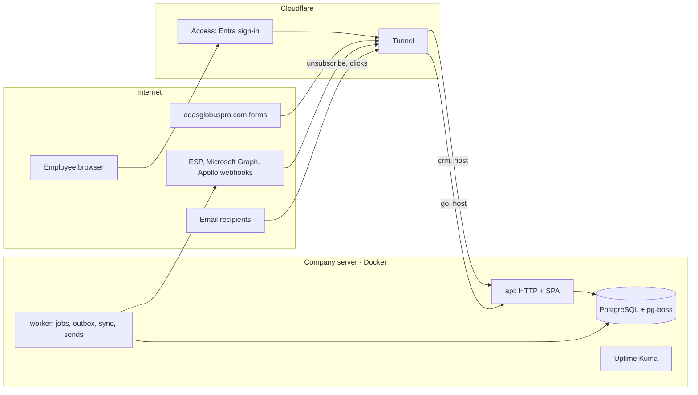
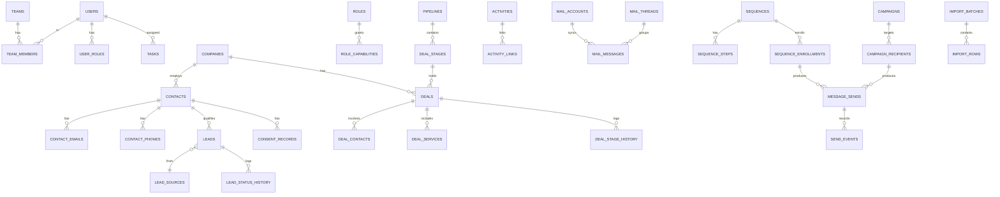

# ADAS CRM: product requirements and architecture

| | |
|---|---|
| Product | ADAS CRM, the internal CRM and outreach platform for ADAS Globus Pro |
| Version | 2.0 (supersedes v1, `Images/ADAS_Globus_Pro_CRM_Product_Requirements_and_Architecture.md`) |
| Date | 4 November 2026 |
| Status | Draft for owner approval |
| Audience | Internal employees only |
| Deployment | Self-hosted on the company server, reached through Cloudflare |
| Companion docs | [`DESIGN.md`](DESIGN.md) (visual system), [`../AGENTS.md`](../AGENTS.md) (rules for the build agent) |

---

## 0. About this document

- **MUST**, **SHOULD** and **MAY** have their usual meaning. Anything not marked is descriptive.
- Each requirement has a phase tag such as **[P2]**. Build nothing before its phase without an approved change.
- Decisions that changed from v1 are listed with reasons in [Appendix A](#appendix-a-review-of-v1-what-changed-and-why).
- Open questions are in [section 15](#15-open-questions). Each has a default, so work can continue until the owner answers.
- This is a product and engineering spec, not legal advice. Section 5 (compliance) needs counsel's sign-off before the first live send.

---

## 1. Product definition

### 1.1 What ADAS CRM is

One internal system that holds every company, person, conversation and deal ADAS Globus Pro works with. It replaces Zoho Bigin and connects the tools sales already uses: the website forms, Microsoft 365 mail, Apollo and (later) n8n.

It covers:

1. Companies, contacts and leads, with imports and duplicate control.
2. Deals in configurable pipelines.
3. Tasks, activities and notes on one timeline.
4. Employee inboxes (Microsoft 365) linked to CRM records.
5. Automated outreach sequences and marketing campaigns, with suppression and consent built in.
6. Website inquiry intake.
7. Reports for sales, marketing and management.
8. An API, events and webhooks for automation.

### 1.2 Business context and sales motion

ADAS Globus Pro sells offshore accounting, tax, audit and back-office staff to CPA and accounting firms in the United States and Canada, delivered from Ahmedabad. The CRM is built around that motion:

```text
Inquiry or outbound prospecting
  → Discovery call
  → 3-day free trial (real client work, reviewed by the prospect)
  → Proposal
  → Negotiation
  → Engagement: part-time, full-time, seasonal or dedicated team
  → Expansion (more staff, more services, next tax season)
```

Facts that shape the design:

- **Two markets.** U.S. and Canadian prospects differ in currency (USD, CAD), anti-spam law (CAN-SPAM, CASL), time zones and tax seasons. `market` is a first-class field.
- **The sales team works from India.** Users work in IST while prospects are on North American time. Every date and time has an explicit time zone.
- **Deals are recurring.** Revenue is a monthly fee per person or team over a term, sometimes seasonal. A single "deal value" number is not enough.
- **The website promises a reply within one business day.** The CRM must make that promise visible and measurable.
- **The company runs on Microsoft 365** (the site books calls through Microsoft Bookings). Sign-in and inbox integration use Microsoft first.

### 1.3 Principles

- One source of truth for company, contact, deal and communication data.
- Company-centric: people belong to firms, and deals belong to firms.
- Every change can be traced: who, what, when, and from which source.
- Sales and marketing share the same records and the same suppression list.
- Suppression and eligibility are enforced in code at send time, not left to users.
- API-first: the web app uses the same public API that integrations use.
- Capability-based access with record-level scope.
- A modular monolith that can grow without a rewrite.
- Small infrastructure: everything runs comfortably on one two-core server.
- The same visual language as adasglobuspro.com, adapted for dense daily work (see `DESIGN.md`).

### 1.4 Scope and non-goals

In scope for v1 is everything in sections 4 to 14.

Not in v1:

- Client accounting documents, client financial credentials or any data from client engagements. The CRM stays separate from delivery systems.
- Native mobile apps. The web app is responsive and usable on a phone for lookups and logging.
- Dark mode, though tokens are structured so it can be added.
- Quoting, invoicing, e-signature or billing. A proposal is tracked as a file or link on the deal.
- Telephony or a dialer. Calls are logged manually.
- AI features, local models, Redis, Elasticsearch, Kafka or microservices.
- Multi-tenant or client-facing portals.
- LinkedIn automation of any kind.

### 1.5 Users and scale (assumptions to confirm, see Q1)

| Dimension | Launch | Design ceiling without redesign |
|---|---|---|
| Named users | up to 40 | 150 |
| Concurrent users | up to 15 | 50 |
| Contacts | 60,000 | 500,000 |
| Companies | 20,000 | 150,000 |
| Activities and messages | 300,000 | 3,000,000 |
| Automated sends per day | up to 1,500 | 20,000 |

---

## 2. Users, roles and permissions

### 2.1 Default roles [P1]

Roles are editable bundles of capabilities. A user can hold several roles, and users belong to one or more **teams** (for example "Sales US" or "Sales Canada").

| Role | Purpose | Default scope |
|---|---|---|
| Super Admin | Configuration, users, integrations, full access | All |
| Sales Manager | Assign leads, manage team deals, approve sequences, see team reports | Team (read all companies and contacts) |
| Sales Executive | Work assigned leads, contacts, deals and tasks | Own (read all companies and contacts) |
| Marketing Manager | Segments, campaigns, templates, approvals, deliverability | All contacts, marketing objects |
| Marketing Executive | Research, list building, campaign drafts | All contacts, own drafts |
| Management | Read-only dashboards and reports | All, read-only |

### 2.2 Capabilities and scopes [P1]

- Capability keys follow `area.action`, for example `leads.read`, `leads.update`, `leads.assign`, `deals.update`, `campaigns.approve`, `data.export`, `data.import`, `records.merge`, `records.delete`, `users.manage`, `settings.manage`, `integrations.manage`, `audit.read`, `privacy.manage`.
- Each grant of a record capability carries a **scope**: `own`, `team` or `all`.
- Permission checks MUST happen in the API and be applied inside the database query (scope becomes a `WHERE` clause). The web app only hides controls; it never enforces.
- Dashboards, search, reports, exports and API responses MUST respect the same scopes.

### 2.3 Visibility rules [P1]

- Everyone with a sales or marketing role can **see** that a company or contact exists, who owns it and when it was last contacted. This prevents two people prospecting the same firm.
- Editing, deals, emails and notes follow the user's scope.
- Email message bodies are visible to the mailbox owner and to roles with `inbox.read_team` for their team only.
- Exports above 1,000 rows need `data.export` with scope `all`, are logged in the audit log and notify Super Admins.

### 2.4 Separation of duties [P5]

- A campaign MUST be approved by someone other than its creator (Super Admin can override, and the override is logged).
- A sequence template marked "team" needs Sales Manager approval before others can enrol contacts.

---

## 3. Domain model

### 3.1 Core concepts

| Concept | What it is | Key rule |
|---|---|---|
| **Company** | A firm or business. The parent record. | Unique by normalised domain when it has one |
| **Contact** | A person, usually at a company | An email address belongs to one contact only |
| **Lead** | A qualification record for one contact: source, status, owner, score | At most one open lead per contact; history is kept |
| **Deal** | A sales opportunity with a company | Lives in exactly one pipeline and stage |
| **Activity** | Something that happened: call, email, meeting, stage change | Immutable once logged (corrections create a new entry) |
| **Task** | Something to do later | Completing a task logs an activity |
| **Note** | Free text pinned to a record | Edit history kept |
| **Market** | `US`, `CA` or `OTHER` | Drives currency, compliance rules and default time zones |
| **Suppression** | An address or domain that must not receive automated mail | Never deleted by ordinary actions |
| **Consent record** | Evidence of a lawful basis to send marketing | Has a source, date and expiry |

Contact data is never deleted because a campaign ended. A contact leaving a firm is an update (the change history keeps the old firm).

### 3.2 Lead lifecycle [P2]

| Status | Category | Notes |
|---|---|---|
| New | open | Created by import, website, Apollo or by hand |
| Researching | open | |
| Contacted | open | Set automatically when the first outbound touch is logged |
| Engaged | open | Set automatically on a reply or a meeting |
| Qualified | qualified | Ready for a deal |
| Disqualified | closed | Reason required (picklist plus note) |
| Converted | closed | Set only by the **Convert** action, which creates or links a deal |

Statuses are configurable, but each maps to a fixed system category (`open`, `qualified`, `closed`) that reports rely on. Every status change is stored in `lead_status_history`.

### 3.3 Pipelines and stages [P3]

Two pipelines are seeded. Both are configurable.

**New business**

| # | Stage | Default probability | Required on entry |
|---|---|---|---|
| 1 | New opportunity | 10% | Company, primary contact, owner |
| 2 | Discovery call | 20% | Meeting date |
| 3 | Free trial | 40% | Trial start and end dates, trial scope |
| 4 | Proposal sent | 60% | Proposal file or link, monthly value |
| 5 | Negotiation | 80% | |
| 6 | Won | 100% | Engagement model, start date, final value |
| 7 | Lost | 0% | Lost reason |

**Expansion** (existing clients): Identified → Proposal sent → Negotiation → Won / Lost. Used for added staff, added services and seasonal renewals.

Stage categories are fixed: `open`, `won`, `lost`. Every stage change is stored in `deal_stage_history`.

### 3.4 Reference lists (seed data) [P2]

These come from the live website. Admins can edit them.

- **Services:** Accounting and bookkeeping; Tax preparation and review; Audit support; Payroll, AP and AR; Dedicated professionals; Full back-office suite.
- **Engagement models:** Part-time; Full-time; Seasonal; Dedicated team; Project.
- **Firm types:** CPA firm; Tax practice (EA); Bookkeeping firm; Audit firm; Business (direct); Other.
- **Company size (staff):** 1–5; 6–20; 21–50; 51–200; 201+.
- **Software** (multi-select on companies): QuickBooks, Xero, Sage, NetSuite, Drake Tax, ProSeries, ProConnect, Lacerte, UltraTax CS, CCH Axcess, CaseWare, Gusto, ADP, Paychex, Bill.com, Dext, SafeSend, Suralink.
- **Lead sources:** Website: trial form; Website: contact form; Apollo; LinkedIn (manual research); Referral; Event; Import; Bigin (legacy); Manual.
- **Lost reasons:** Price; Chose another provider; Hiring locally or in-house; Data security concerns; Trial outcome; Timing; No response; Other.
- **Disqualify reasons:** Not a fit (size or type); No outsourcing need; Existing client; Competitor; Bad data; Asked not to be contacted; Other.
- **Contact roles on a deal:** Decision maker; Influencer; Reviewer; Day-to-day contact; Billing.

---

## 4. Functional requirements

### 4.1 App shell and navigation [P1]

- Left sidebar (navy, see `DESIGN.md`) with groups:
  - **Work:** Dashboard, Inbox [P4], Tasks [P3]
  - **Records:** Leads, Contacts, Companies, Deals [P3]
  - **Grow:** Outreach (Sequences and Campaigns) [P5], Reports [P3]
  - **Bottom:** Settings, Help
- Modules not yet built are hidden, not shown disabled.
- Top bar: global search (Ctrl/⌘ K), **New** menu (Lead, Contact, Company, Deal, Task, Note), notifications, user menu (profile, time zone, sign out).
- Every list and profile has a shareable URL. Filters and sort state live in the URL.

### 4.2 Dashboard [P3, basic version P2]

Widgets are role-based and every number links to the filtered list behind it. Definitions are in [section 14](#14-metric-definitions).

| Role | Widgets |
|---|---|
| Sales Executive | My follow-ups due today; my overdue tasks; inquiries waiting for a first reply (SLA clock); my open leads by status; my pipeline by stage; recent replies |
| Sales Manager | Team pipeline and weighted pipeline; won and lost this month; win rate; SLA breaches; overdue tasks by person; leads by source and market |
| Marketing | Sequence and campaign performance; reply rate; bounce and complaint rates; suppression growth; deliverability health |
| Management | Revenue won (period); pipeline value; win rate; trial-to-win rate; leads by source and market; activity summary by team |

Each widget has a date-range control where it applies. Widgets load independently, so one slow query never blocks the page.

### 4.3 Companies [P2]

**Fields:** name; website; normalised domain; market; country; state or province; city; address; firm type; size band; software (multi); industry; LinkedIn company URL; description; annual revenue (only from legitimate sources, with source noted); lead source; account owner; account status (Prospect, Active client, Former client, Partner, Do not contact); tags; custom fields; created and updated timestamps and users.

**Features:**
- Profile with a header (name, market, owner, status, local time), a right rail (key facts, contacts, open deals, next task) and tabs: Overview, Activity, Contacts, Deals, Emails [P4], Notes, Files, History.
- Domain normalisation: lowercase; strip scheme, `www.`, path and port; reduce to the registrable domain using the Public Suffix List. **Free-mail domains** (gmail.com, outlook.com, yahoo.com, icloud.com and others on a maintained list) MUST never create or match a company domain.
- Account status "Do not contact" suppresses the whole domain for automated mail.

### 4.4 Contacts [P2]

**Fields:** first name; last name; job title; seniority (Partner/Owner, Manager, Staff, Other); company; country; state or province; IANA time zone (defaults from location); several emails (one primary) with verification status; several phones (stored in E.164, one primary); LinkedIn URL; owner; tags; do-not-contact flag; marketing basis (derived, see 5.3); custom fields.

**Features:**
- Profile tabs: Overview, Activity, Emails [P4], Deals, Notes, Outreach history [P5], Consent and suppression, History.
- Local time shown next to the name ("9:14 am in Toronto").
- Global unsubscribe and suppression status always visible on the profile header.

### 4.5 Leads [P2]

**Fields:** contact; company; source and source detail (form, Apollo list name, import batch); status; disqualify reason; owner; score [P6]; last contacted; next follow-up; converted deal; created date.

**Features:**
- Table view with saved views, filters, sorting, column chooser and density toggle.
- Bulk actions: assign, change status, tag, add to sequence [P5], export (permissioned), delete (soft, permissioned).
- Assignment rules [P2]: manual, or round-robin within a team chosen by market. Assignment notifies the new owner.
- **Convert** creates a deal in the chosen pipeline (or links an existing one), copies the contact as primary contact and sets status to Converted.
- Lead scoring [P6]: rule-based. Fit points (firm type, size, market, software) plus engagement points (reply, meeting, click). Weights in Settings. Opens are never scored.

### 4.6 Deals [P3]

**Fields:** name; company; primary contact and other contacts with roles; pipeline; stage; owner; market; currency (USD or CAD); engagement model; services (multi); FTE count (decimal); monthly value; term in months (default 12); one-time value; contract value (computed: monthly × term + one-time); probability (stage default, can be overridden); expected close date; trial start and end dates; trial scope; proposal link or file; start date; closed date; lost reason and note; FX rate at close (set automatically); notes; related activities.

**Features:**
- Kanban board per pipeline with drag and drop. Column headers show count and total value in the reporting currency. Required-on-entry fields (3.3) open a small dialog before the move completes.
- Table view with the same filters and saved views as other lists.
- Weighted value = contract value × probability.
- Moving a deal to Won or Lost sets `closed_at` and stores the FX rate. Reopening clears them and is logged.
- Deals idle for more than N days in an open stage are flagged (N per stage, default 14).

### 4.7 Tasks, activities and notes [P3, timeline in P2]

- **Task types:** Call, Email, Follow-up, Meeting, Research, Trial check-in, Proposal, Internal.
- **Task fields:** title; type; priority (Low, Normal, High); due date and time or all-day; reminder; assignee; related record (company, contact, lead or deal); status; completion time and user.
- Views: My tasks (Today, Overdue, Upcoming, Done), Team tasks (managers), Calendar (week and month).
- "Today" and "Overdue" are calculated in the **assignee's** time zone.
- Completing a task MAY prompt for an outcome note, which becomes the activity body.
- **Activity timeline** on every record, newest first, grouped by day. It includes logged calls and meetings, emails [P4], sequence steps [P5], status and stage changes, assignments, imports, merges and notes. Filter by type.
- An activity can link to several records (contact, company, deal) without duplication.
- Logging a call or meeting takes one keyboard shortcut from any record.

### 4.8 Search, saved views and filters [P2]

- Global search across companies, contacts, leads, deals, tasks and (from P4) email subjects. Results are grouped by type, keyboard-navigable and permission-aware.
- Matching: exact email and domain; prefix and fuzzy name matching (trigram); full-text for notes and email subjects.
- One **filter language** (section 6.8) powers list filters, saved views, segments, bulk actions and report filters.
- Saved views can be private or shared with a team. Each has a name, filters, columns, sort and density.

### 4.9 Imports and data quality [P2]

- Upload CSV or XLSX, up to 50 MB and 100,000 rows per file.
- **Steps:** upload → column mapping (saved mapping templates) → choose the entity and match rules → **dry run** with a preview of creates, updates, duplicates and errors → confirm → background processing with live progress.
- Every row is recorded in `import_rows` with its result and errors. A downloadable error CSV contains the original row plus an error column.
- **Undo import:** an import batch can be rolled back within 7 days. Records it created are soft-deleted and field updates it made are reverted, unless a user has edited them since (those are listed instead).
- Every imported record keeps its source, import batch and any provider IDs.
- **Duplicate rules:**

  | Entity | Definite match (auto-link or update) | Probable match (queue for review) |
  |---|---|---|
  | Contact | Same normalised email | Same first and last name with the same company domain; or same E.164 phone |
  | Company | Same normalised domain | Name trigram similarity ≥ 0.8 in the same country |

- **Duplicate queue:** probable matches wait in a review queue. Merge lets the user pick the surviving value per field, re-points all relations (emails, deals, activities, tasks, notes, tags, external IDs), keeps a merge snapshot and logs the merge. A merge can be undone from the snapshot within 30 days.
- **Exports:** CSV of the current view, permission-checked, audited, runs in the background above 5,000 rows.
- Phones are normalised with libphonenumber, using the record's country as the default region.

### 4.10 Website inquiries [P2]

The website forms already POST JSON to whatever URL is set in their `data-endpoint` attribute. The CRM provides that endpoint, so the only website change is setting the attribute.

- **Endpoint:** `POST https://go.adasglobuspro.com/api/v1/public/inquiries`
- **CORS:** allow `https://www.adasglobuspro.com` and `https://adasglobuspro.com`, method `POST`, header `Content-Type`. Answer preflight requests.
- **Payloads accepted as the site sends them today:**

  | Form | Fields |
  |---|---|
  | Free-trial form (homepage) | `name`, `email`, `firm`, `phone`, `need`, `country` ("United States" or "Canada"), `software`, `message` |
  | Contact form | `name`, `email`, `firm`, `phone`, `location` (state, province or "Outside the U.S. and Canada"), `interests` (comma-separated), `message`, `website` (honeypot, must be empty) |

  Tell the forms apart by their fields (`need` means the trial form). An optional `form` field MAY be added to the site later.
- **Processing** (inside one transaction, idempotent on a hash of email, form and day):
  1. Store the raw submission in `inquiries`, with time, form, hashed IP and user agent, as consent evidence.
  2. Match or create the contact by email, and the company by domain (or by firm name when the domain is free-mail).
  3. Create a lead with source "Website: trial form" or "Website: contact form", set the market from `country` or `location`, and attach `need`, `interests` and `software` to the lead and company.
  4. Assign an owner by the routing rule for that market (Q13).
  5. Create a task **"Reply to website inquiry"** due one business day later in the prospect's time zone, and start the SLA clock.
  6. Record a consent record of type `inquiry` (see 5.3).
  7. Notify the owner in the app and by email.
- **Abuse protection:** honeypot check, per-IP rate limit (5 per 10 minutes), body size limit (16 KB), strict validation. Always return a generic 2xx to bots so they learn nothing. Cloudflare Turnstile MAY be added later; it needs a website change.
- **Response:** `202 {"status":"received"}`. The site already shows its own thank-you message.

### 4.11 Inbox (Microsoft 365) [P4]

- Each user connects their own mailbox with OAuth (delegated permissions). No mailbox passwords are ever stored.
- **Sync rule:** a message is stored only if a participant's address matches a CRM contact, or its domain matches a CRM company domain (not free-mail), or the user links it by hand. Personal and internal-only mail is never stored.
- **Features:** conversation threads on contact, company and deal timelines; send and reply from the CRM (sent through the user's own mailbox, so it appears in Outlook Sent Items); templates and variables; link a thread to a deal; create a task from an email; outbound status (sent, failed).
- Attachments: store metadata only. Fetch the file from Microsoft Graph on demand when a user opens it.
- Gmail support is built behind the same provider interface **only if** Q2 confirms someone needs it.

### 4.12 Sequences: personal outreach [P5a]

Automated multi-step outreach that sends **from the owner's own connected mailbox** at human volume. This is the channel for prospecting.

- A sequence has steps: an **email step** (template, delay in business days, optional "reply in thread") or a **task step** (call, LinkedIn research), with delays between them.
- **Send window:** recipient's local time, business days, 08:00–17:00 by default. Sends are spread through the window, not burst.
- **Caps:** per mailbox per day (default 50, admin can raise it up to 150), and per contact (see 5.6).
- **Enrolment:** from a list, view or bulk action. Eligibility (section 5) is checked at enrolment and again before each send. Ineligible contacts are skipped with a visible reason.
- **Stop conditions:** reply (from any address at the same company domain, by default), meeting booked, unsubscribe, bounce, complaint, deal created, manual removal, sequence paused, owner's mailbox disconnected.
- A reply pauses the contact's sequence and creates a task for the owner.
- Plain-text-first templates with personalisation variables, a short opt-out line and the sender's postal address footer (5.5).
- Open tracking is off. Click tracking is off by default.
- Reports: enrolled, sent, replied, bounced, unsubscribed, meetings, and reply rate per step.

### 4.13 Marketing campaigns [P5b]

One-to-many email (newsletters, announcements, seasonal offers) sent through an external email service provider (ESP) from a dedicated sending subdomain. **Only contacts with a valid marketing basis are eligible** (section 5).

- **Audience:** segments (dynamic, filter language) and static lists. The audience is snapshotted when the campaign starts sending.
- **Templates:** a simple block editor (heading, text, button, image, divider) that renders responsive HTML with inline styles plus a plain-text part. Variables come with fallbacks.
- **Workflow:** Draft → Pending approval → Approved → Scheduled → Sending → Completed. It can be Paused or Cancelled from Approved, Scheduled or Sending. Editing an approved campaign returns it to Draft.
- **Approval** by a second person (2.4), with a test send to internal addresses and a pre-flight checklist: sender verified, unsubscribe link present, postal address present, audience eligible count, suppression count.
- Scheduled sending with throttling (per hour), recipient time-zone option, and automatic pause when health thresholds are crossed (5.6).
- Bounce, complaint, delivery and click events arrive by provider webhook and update the contact (hard bounce → address marked invalid; complaint → global suppression).
- Reports: sent, delivered, hard and soft bounces, complaints, unsubscribes, clicks by link, replies where known. Opens are shown only with an "unreliable" label, and never used in automation.

### 4.14 Integrations [P6, except where noted]

| Integration | Purpose | Notes |
|---|---|---|
| Website forms | Inquiry intake | [P2], section 4.10 |
| Microsoft Entra ID | Single sign-on | [P1] |
| Microsoft 365 mail | Inbox, sequences, notification email | [P3–P5] |
| ESP (to be chosen, Q5) | Campaign delivery and events | [P5b] |
| Apollo | People and company search, enrichment, list import | Uses the company's Apollo API key; shows the credit cost before any enrichment; never enriches in bulk without confirmation; stores Apollo IDs in `external_ids`. After cutover the CRM owns sequences, so the same contacts must not also run in Apollo sequences. |
| Microsoft Bookings | Booked calls become meeting activities and tasks | Matched by attendee email |
| LinkedIn Sales Navigator | Manual research only | Store the URL. No scraping, no automation, no browser extensions acting on accounts. |
| n8n | External workflows | Uses signed outbound webhooks and a scoped API token; runs as its own container in P6 |
| CSV/XLSX | Imports and exports | [P2] |
| Zoho Bigin | One-time migration | Section 13 |

- **Outbound webhooks:** admin-managed endpoints subscribe to event types and are signed with HMAC-SHA256 (`X-ADAS-Signature`, timestamp included, 5-minute replay window). Delivery is retried with exponential backoff for up to 24 hours, and a delivery log is kept.
- **API tokens:** service tokens with explicit capabilities and scope. They are stored hashed, shown once, can expire and are audited.

### 4.15 Reports [P3, advanced P6]

- Standard reports: leads by source, market and owner; lead funnel and conversion; pipeline by stage and owner; won and lost with reasons; win rate; trial-to-win rate; average sales cycle; revenue won by owner and service; inquiry response time (SLA); activity by user; follow-up completion; sequence and campaign performance; deliverability.
- Every report has a date range, a market filter, owner and team filters, a "view as table" toggle and CSV export (permissioned and audited).
- Money is shown in the **reporting currency** (default USD, Q8) using stored FX rates: rate at close for won deals, latest rate for open pipeline. The original currency is always one click away.
- Heavy aggregates MAY use materialised views refreshed by a job every 15 minutes. The report shows "Updated N min ago".

### 4.16 Notifications [P2 in-app, P3 email]

- In-app notification centre: assignments, mentions in notes, replies, SLA warnings (4 hours before breach), task reminders, import finished, export ready, approval requests.
- Email: an optional daily digest at 09:00 in the user's time zone, plus immediate email for assignments and SLA breaches (user preferences). It is sent through Microsoft Graph from a dedicated shared mailbox such as `crm@adasglobuspro.com`.

### 4.17 Administration [P1 onward]

Users and teams; roles and capabilities; pipelines and stages; lead statuses and reasons; reference lists; custom fields (text, number, money, date, select, multi-select, boolean, URL); routing rules; business hours and holidays (per market, for SLA and send windows); FX rates; mailbox connections overview; sender identities and sending domains [P5]; suppression list management (add, import, view; removal needs `privacy.manage` and a reason); integrations and API tokens; webhooks; retention policies; audit log viewer; system health (job queues, last backup, sync status).

### 4.18 Privacy operations [P2]

- **Access request:** export everything held about a person (contact, emails, activities, consent, suppression) as JSON plus CSV.
- **Erasure:** hard-delete the person's personal fields, email bodies and notes about them. Keep a hashed suppression entry so they are never re-imported and mailed. Keep anonymised activity counts for reports.
- **Retention jobs** (defaults, Q10): import files 30 days; email bodies 24 months after the last activity on the contact; inquiries 24 months; audit log 3 years; backups 35 days.
- Every privacy action is audited and needs `privacy.manage`.

---

## 5. Compliance and deliverability

Owning a contact's address, for example from Apollo, does **not** give permission to market to it. The CRM enforces this with an eligibility engine. Counsel MUST review these rules before the first live send (Q6).

### 5.1 Eligibility engine [P5]

One function, `checkSendable(contact, channel, message)`, used at enrolment, approval and **immediately before every send**. It returns `ok`, or a reason code. Reason codes include:

`no_valid_email`, `email_invalid_or_bounced`, `suppressed_address`, `suppressed_domain`, `unsubscribed`, `complained`, `do_not_contact`, `no_marketing_basis`, `basis_expired`, `market_not_configured`, `frequency_cap`, `already_sent_this_step`, `in_other_active_sequence`, `campaign_not_approved`, `campaign_paused`, `sender_not_verified`, `mailbox_disconnected`, `outside_send_window`.

Every skip is recorded with its reason so users can see why someone was not mailed.

### 5.2 Market rules [P5]

| Market | Law | What the engine requires |
|---|---|---|
| US | CAN-SPAM | Accurate headers and subject; working opt-out honoured at once (the law allows 10 business days); valid postal address; opt-out works for at least 30 days after sending. Cold B2B outreach is allowed if these hold. |
| CA | CASL | A valid consent basis before sending: express consent, or implied consent such as an inquiry (valid 6 months), an existing business relationship (2 years) or conspicuous publication (address published, relevant to the person's role, no "no unsolicited email" notice). Sender identification and contact details; unsubscribe works for at least 60 days and is honoured at once. **No basis means no send.** |
| OTHER | (UK, EU, others) | Blocked until an admin configures rules after legal advice. |

India's Digital Personal Data Protection Act applies because data is processed on a server in India. Counsel to confirm notice and retention duties (Q6).

### 5.3 Consent and basis records [P2 storage, P5 enforcement]

- `consent_records`: contact, email, basis (`express`, `implied_inquiry`, `implied_ebr`, `implied_published`, `legitimate_interest_b2b`), purpose (`marketing`, `outreach`), source, evidence (inquiry ID, form, URL, note), obtained at, **expires at**, withdrawn at, recorded by.
- A contact's **marketing basis** is derived from their records and market. It shows on the profile as Express, Implied until a date, US B2B outreach only, or None.
- Website inquiries create `implied_inquiry` automatically. A won deal creates `implied_ebr` for the client's contacts.
- Imports MAY set a basis only with a source and evidence note. The default is none.

### 5.4 Sending domains and authentication [P5]

- **Sequences** send from employees' Microsoft 365 mailboxes on `adasglobuspro.com`. This protects deliverability by keeping volume human (caps in 4.12) and stopping on replies. See Q4 for a separate outreach domain.
- **Campaigns** send through the ESP from a dedicated subdomain (proposed `mail.adasglobuspro.com`), **never** from the root domain employees use for client mail.
- SPF, DKIM (2048-bit) and DMARC MUST be set up for every sending domain. Start DMARC at `p=none` with reports, then move to `quarantine` once alignment is clean.
- Click-tracking and unsubscribe links use the company's own link host (`go.adasglobuspro.com`), not a shared ESP domain.
- New sending domains warm up gradually. The engine enforces a ramp schedule set in Settings.

### 5.5 Message requirements [P5]

- **Campaigns:** `List-Unsubscribe` and `List-Unsubscribe-Post: List-Unsubscribe=One-Click` headers (RFC 8058), plus a visible unsubscribe link.
- **Sequences:** a short opt-out line ("If you'd rather not hear from me, reply 'no thanks' or use this link") and the same one-click headers.
- **Postal address by market:** U.S. recipients get the Sheridan, Wyoming office; Canadian recipients get the Edmonton, Alberta office (taken from Settings, which are seeded from the website).
- Sender name is a real person. Subjects are not deceptive. Mail-provider bulk-sender rules (Google, Yahoo, Microsoft) are followed at every volume.
- The unsubscribe page works without login, confirms in one click, offers "unsubscribe from all" and records the event immediately.

### 5.6 Guardrails [P5]

- **Frequency cap:** at most one automated message per contact every 3 business days across all sequences and campaigns (configurable). Only one active sequence per contact.
- **Auto-pause** a campaign or a sender when, after at least 200 deliveries, the hard-bounce rate is above 3% or the complaint rate is above 0.1%. Notify the owner and Marketing Manager.
- Contacts whose email verification status is unknown or "risky" are excluded from campaigns by default.
- Suppression always wins. No user action, import or API call can mail a suppressed address. Removing a suppression requires `privacy.manage`, a reason and an audit entry.

---

## 6. Architecture

### 6.1 Shape

A **modular monolith** in one TypeScript monorepo. One API image runs in two modes, **HTTP** and **worker**. The web app is a static single-page app served by the API container. PostgreSQL is the only stateful service, and it also runs the job queue.



### 6.2 Technology stack

| Layer | Choice | Notes |
|---|---|---|
| Language | TypeScript (strict) everywhere | |
| Runtime | Node.js Active LTS at project start | |
| Package manager | pnpm workspaces | |
| Web app | React + Vite single-page app | **Changed from v1 (Next.js).** Internal, behind sign-in, no SEO; a static build needs no extra Node process |
| Routing and data | TanStack Router, TanStack Query, TanStack Table (+ Virtual) | |
| UI | Tailwind CSS v4, shadcn/ui, Lucide icons | Themed with `DESIGN.md` tokens |
| Forms | react-hook-form + zod | Schemas shared with the API |
| Charts | Recharts (through shadcn charts) | |
| Drag and drop | dnd-kit | Kanban |
| Rich text | Tiptap (limited marks) | Notes and templates |
| API | NestJS | REST, OpenAPI generated |
| Validation | zod (shared package) through a NestJS pipe | **Changed from v1 (class-validator).** One schema for web and API |
| ORM | Prisma | Hand-written SQL in migrations for what Prisma cannot express (6.10, 7.4) |
| Database | PostgreSQL, latest stable major (17 or newer) | Extensions: `pg_trgm`, `unaccent`, `pgcrypto` |
| Jobs | pg-boss | In the same database. No Redis |
| Auth | Microsoft Entra ID (OIDC) + server sessions | **Changed from v1 (passwords + JWT refresh).** Break-glass local admin only |
| Mail | Microsoft Graph; ESP adapter (Q5) | Gmail adapter only if needed |
| Files | Local volume behind a storage interface | S3-compatible later without code changes |
| Logs | pino (JSON) | No personal data in logs |
| Tests | Vitest, Testcontainers (PostgreSQL), Playwright, k6 | |
| Hosting | Ubuntu Server LTS + Docker Compose | |
| Edge | Cloudflare Tunnel + Cloudflare Access | |
| Automation | n8n Community Edition | Phase 6 only |
| Monitoring | Uptime Kuma + one external uptime check | |

### 6.3 Repository layout

```text
adas-crm/
├── AGENTS.md                 Rules for the build agent
├── CLAUDE.md                 Points Claude Code at AGENTS.md
├── README.md                 Setup, commands, operations index
├── docs/
│   ├── PRD.md                This document
│   ├── DESIGN.md             Visual system
│   ├── PROGRESS.md           Phase checklist, kept current by the agent
│   ├── decisions/            Architecture decision records (0001-*.md)
│   └── runbooks/             Deploy, restore, rotate keys, offboard user, incident
├── apps/
│   ├── web/                  React SPA
│   │   └── src/{app,routes,features/<module>,components/ui,lib,styles}
│   └── api/                  NestJS: main.ts (HTTP) and worker.ts (jobs)
│       ├── prisma/{schema.prisma,migrations/,seed.ts}
│       └── src/
│           ├── platform/     config, db, auth, permissions, audit, outbox, jobs, crypto, files, mail-transport
│           └── modules/      users, teams, companies, contacts, leads, deals, tasks, activities,
│                             notes, tags, custom-fields, search, imports, dedupe, intake, inbox,
│                             sequences, campaigns, compliance, integrations, webhooks, reports,
│                             notifications, settings, privacy
├── packages/
│   ├── shared/               zod schemas, enums, capability keys, filter-language types
│   └── config/               tsconfig, eslint, prettier presets
├── infra/
│   ├── compose.yml           Production stack
│   ├── compose.dev.yml       Local stack (PostgreSQL, Mailpit)
│   ├── cloudflared/          Tunnel ingress config (no secrets)
│   ├── postgres/             postgresql.conf overrides
│   └── backup/               Backup and restore scripts
├── scripts/                  deploy.sh, restore-drill.sh, seed-synthetic.ts
├── .env.example              Every variable, documented, no real values
└── .github/workflows/ci.yml
```

### 6.4 Module boundaries

- Each module owns its tables and exports a small service interface from its `index.ts`. Other modules MUST NOT query its tables or import its internals. This is enforced by a lint rule (dependency-cruiser or eslint boundaries).
- Cross-module side effects go through **domain events** written to the outbox (6.9), not direct calls, when the reaction can happen later (for example `deal.won` → create a consent record).
- `platform/` holds shared infrastructure. Business modules depend on platform, never the other way.
- Read-only reporting MAY query across modules through SQL views owned by the `reports` module.

### 6.5 Hosts and routing

| Host | Behind Cloudflare Access | Serves |
|---|---|---|
| `crm.adasglobuspro.com` | Yes (Entra, company accounts only) | SPA and `/api/v1/*` |
| `go.adasglobuspro.com` | **No** (public) | `/u/:token` unsubscribe, `/c/:token` click redirect, `/api/v1/public/*` (website intake), `/api/v1/webhooks/*` (ESP, Graph notifications), `/healthz` |
| `status.adasglobuspro.com` | Yes | Uptime Kuma |
| `automation.adasglobuspro.com` | Yes | n8n (P6) |

- cloudflared routes both CRM hosts to the same `api` container. The API MUST check the `Host` header: public controllers answer only on `go.`, and everything else answers only on `crm.`.
- The API SHOULD also validate the Cloudflare Access JWT (`Cf-Access-Jwt-Assertion`) on `crm.` requests as defence in depth.
- PostgreSQL and all internal ports stay on a private Docker network. Nothing listens on the server's public interfaces.

### 6.6 Authentication and sessions [P1]

- **Primary:** OIDC authorization-code flow with PKCE against a single-tenant Entra app registration (certificate credential preferred). Users are matched by Entra object ID. First sign-in creates the user only if an admin has invited that email.
- **Break-glass:** at most two local admin accounts with Argon2id passwords and TOTP MFA, for when Entra is unavailable. Their use is audited and alerted.
- **Sessions:** a random token in a `__Host-` cookie (`Secure`, `HttpOnly`, `SameSite=Lax`), stored hashed in `sessions`. 12-hour idle timeout, 7-day absolute limit. Deactivating a user revokes all their sessions at once.
- **CSRF:** SameSite cookies plus an `Origin` header check on every state-changing request.
- MFA for normal users comes from Entra (Conditional Access).
- Endpoints: `GET /auth/sso/start`, `GET /auth/sso/callback`, `POST /auth/logout`, `GET /auth/me`, `POST /auth/local/login` (break-glass only).

### 6.7 API conventions

- Base path `/api/v1`, JSON, `camelCase` in JSON and `snake_case` in the database.
- **Lists:** `GET /contacts?limit=50&cursor=…&sort=-updatedAt&q=…` with simple filters as query parameters, or `POST /contacts/query` with a filter-language body (6.8). Keyset (cursor) pagination; `limit` maximum 200. Totals are returned when they are cheap, otherwise marked as estimates.
- **Errors:** RFC 9457 `application/problem+json` with a stable `code` and a field-level `errors[]`.
- **Optimistic concurrency:** mutable records have an integer `version`. `PATCH` MUST send it and gets `409 conflict` if the record has changed.
- **Idempotency:** `Idempotency-Key` header on POSTs that create records or send mail. Responses are stored for 24 hours.
- **Bulk actions:** `POST /{entity}/bulk` with `{action, ids | filter}`. More than 500 records run as a job and return a job ID with a progress endpoint.
- **OpenAPI** is generated from the zod schemas and served at `/api/docs` (internal host only). The web client is generated from it.
- **Rate limits:** per user on the internal host, per IP on the public host.

Key endpoints (not exhaustive; every module exposes CRUD plus its actions):

| Area | Endpoints |
|---|---|
| Auth | as in 6.6 |
| Companies | `GET/POST /companies`, `GET/PATCH/DELETE /companies/:id`, `POST /companies/:id/merge` |
| Contacts | `GET/POST /contacts`, `POST /contacts/query`, `GET/PATCH/DELETE /contacts/:id`, `POST /contacts/:id/merge`, `GET /contacts/:id/timeline` |
| Leads | `GET/POST /leads`, `PATCH /leads/:id`, `POST /leads/:id/convert`, `POST /leads/bulk` |
| Deals | `GET/POST /deals`, `PATCH /deals/:id`, `POST /deals/:id/move` (stage change with required fields), `GET /pipelines` |
| Tasks | `GET/POST /tasks`, `PATCH /tasks/:id`, `POST /tasks/:id/complete` |
| Activities | `GET /activities?entity=…`, `POST /activities` |
| Search | `GET /search?q=` |
| Imports | `POST /imports` (upload), `POST /imports/:id/dry-run`, `POST /imports/:id/run`, `POST /imports/:id/rollback`, `GET /imports/:id/errors.csv` |
| Inbox | `POST /mail-accounts/connect`, `GET /threads?entity=…`, `POST /messages/send` |
| Sequences | `GET/POST /sequences`, `POST /sequences/:id/enroll`, `POST /enrollments/:id/stop` |
| Campaigns | `GET/POST /campaigns`, `POST /campaigns/:id/submit`, `/approve`, `/schedule`, `/pause`, `/cancel`, `POST /campaigns/:id/test-send` |
| Reports | `GET /reports/:reportKey?from=&to=&market=` |
| Public | `POST /public/inquiries`, `GET/POST /u/:token`, `GET /c/:token` |
| Webhooks in | `POST /webhooks/:provider` |
| Admin | `/users`, `/teams`, `/roles`, `/settings`, `/custom-fields`, `/api-tokens`, `/webhook-endpoints`, `/audit-logs` |

### 6.8 Filter language

One JSON structure for list filters, saved views, segments, bulk actions and report filters:

```json
{
  "and": [
    { "field": "company.market", "op": "eq", "value": "US" },
    { "field": "company.firmType", "op": "in", "value": ["CPA firm", "Tax practice (EA)"] },
    { "field": "lead.status", "op": "eq", "value": "Qualified" },
    { "field": "email.verificationStatus", "op": "eq", "value": "valid" },
    { "or": [
      { "field": "tags", "op": "hasAny", "value": ["tax-season-2027"] },
      { "field": "lastContactedAt", "op": "before", "value": { "relative": "-90d" } }
    ]}
  ]
}
```

- Fields come from a per-entity **field registry** that whitelists each path, its type, its SQL expression and its allowed operators. User input never becomes SQL text.
- Operators: `eq`, `neq`, `in`, `nin`, `contains`, `startsWith`, `gt`, `gte`, `lt`, `lte`, `between`, `before`, `after`, `isEmpty`, `isNotEmpty`, `hasAny`, `hasAll`.
- Custom fields are addressable as `custom.<key>`.
- The scope filter (2.2) is always added on top of user filters.

### 6.9 Events, jobs and the outbox

**Transactional outbox:** the business change and its event row are written in the same transaction. The worker claims unprocessed events (`FOR UPDATE SKIP LOCKED`), dispatches them to handlers and outbound webhooks, and marks them done. Handlers MUST be idempotent (the event ID is the dedupe key). Failures retry with backoff and are dead-lettered after 10 attempts, with a visible alert.

**Event catalogue** (past tense, `entity.action`):

```text
company.created  company.updated  company.merged
contact.created  contact.updated  contact.merged  contact.erased
lead.created  lead.assigned  lead.status_changed  lead.qualified  lead.converted
deal.created  deal.stage_changed  deal.won  deal.lost  deal.reopened
task.created  task.completed  task.overdue
activity.logged  note.created
inquiry.received
email.received  email.sent  email.replied
sequence.enrolled  sequence.step_sent  sequence.stopped
campaign.approved  campaign.scheduled  campaign.started  campaign.completed  campaign.paused
recipient.bounced  recipient.complained  recipient.unsubscribed  recipient.clicked
import.completed  import.rolled_back
suppression.added  suppression.removed
```

**Job catalogue** (pg-boss queues):

| Queue | Trigger | Notes |
|---|---|---|
| `outbox.dispatch` | every 2 s | Process events |
| `import.process` | on run | Batches of 500 rows, progress updates |
| `export.build` | on request | Writes a file and notifies |
| `mail.sync` | Graph notification or every 5 min | Delta per folder per account |
| `mail.subscriptions.renew` | hourly | Renew Graph subscriptions before they expire |
| `sequence.tick` | every minute | Find due steps inside send windows |
| `send.message` | per message | Runs the eligibility check, then sends; idempotent on `(enrollment, step)` or `(recipient)` |
| `campaign.tick` | every minute | Start scheduled campaigns, throttle |
| `webhook.deliver` | per delivery | Outbound webhooks with retries |
| `tasks.reminders` | every minute | Reminders and overdue events |
| `sla.check` | every 5 min | Inquiry SLA warnings and breaches |
| `reports.refresh` | every 15 min | Materialised views |
| `retention.run` | nightly | Section 4.18 |
| `fx.refresh` | daily (optional) | Exchange rates |

### 6.10 Search

- `pg_trgm` GIN indexes on company name, contact full name, normalised email and domain for fuzzy and prefix search.
- A generated `tsvector` column (`simple` configuration) on companies, contacts, deals and notes, and on email subjects from P4. To fold accents, wrap `unaccent` in an `IMMUTABLE` SQL function first; the built-in function can't be used in generated columns or indexes.
- `/search` runs one query per entity type in parallel, limits each to 8 results and merges them.
- No Elasticsearch. Revisit only if p95 search latency breaks budget (12.2) at the design ceiling.

### 6.11 Files

- One storage interface (`put`, `get`, `delete`, `signedUrl`). The P1 implementation is a local Docker volume with keys like `imports/2026/11/<uuid>.xlsx`.
- The database stores only key, size, type, checksum and owner.
- Upload limits: 50 MB for imports, 20 MB for attachments. Files are type-checked by content, not just extension.
- Files are served only through the API after a permission check, never from a public path.

---

## 7. Data model

### 7.1 Conventions

- **IDs:** UUIDv7 (time-ordered, better index locality), generated in the application, or by `uuidv7()` on PostgreSQL 18 and newer.
- **Time:** `timestamptz` everywhere, stored in UTC. Dates without time (expected close, trial dates) use `date`.
- **Audit columns** on business tables: `created_at`, `created_by`, `updated_at`, `updated_by`, `version`.
- **Soft delete:** `deleted_at` on companies, contacts, leads, deals, tasks and notes. Unique indexes are partial (`WHERE deleted_at IS NULL`). Soft-deleted records are purged after 90 days unless on legal hold.
- **Money:** `bigint` minor units (cents) plus `char(3)` currency. Never floats.
- **Configurable lists** (statuses, stages, sources, reasons, services) are lookup tables with a fixed `category`. Fixed technical values (message direction, event type) are check-constrained text.
- **Custom fields:** a `custom_fields jsonb` column on companies, contacts, leads and deals, validated against `custom_field_definitions`, with a GIN index. **Changed from v1 (EAV table).**
- **Polymorphic links** (`entity_type`, `entity_id`) are used only for taggings, notes, activity links, files and record history. They carry a check constraint on `entity_type` and a composite index, and the owning service cleans them up on delete or merge.
- **Normalisation:** emails are trimmed and lowercased into `email_normalized`; domains as in 4.3; phones to E.164.

### 7.2 Entity relationship overview



### 7.3 Table catalogue

Important columns only. Every business table also has the audit columns from 7.1.

**Identity and access**

| Table | Columns |
|---|---|
| `users` | id, email, display_name, entra_object_id (unique), status (invited, active, deactivated), time_zone, last_login_at |
| `teams` | id, name, market |
| `team_members` | team_id, user_id, is_lead |
| `roles` | id, name, description, is_system |
| `capabilities` | key (PK), description |
| `role_capabilities` | role_id, capability_key, scope (own, team, all) |
| `user_roles` | user_id, role_id |
| `sessions` | id, token_hash, user_id, created_at, last_seen_at, expires_at, ip, user_agent, revoked_at |
| `local_credentials` | user_id, password_hash (Argon2id), totp_secret_ciphertext (break-glass only) |
| `api_tokens` | id, name, token_hash, owner_user_id, capabilities jsonb, expires_at, last_used_at, revoked_at |
| `audit_logs` | id, occurred_at, actor_user_id, actor_token_id, action, entity_type, entity_id, ip, details jsonb. Append-only |

**CRM records**

| Table | Columns |
|---|---|
| `companies` | id, name, website, domain, market, country, region, city, address jsonb, firm_type_id, size_band, software text[], industry, linkedin_url, description, annual_revenue_minor, revenue_currency, revenue_source, source_id, owner_id, account_status, custom_fields, search tsvector, deleted_at |
| `contacts` | id, company_id, first_name, last_name, job_title, seniority, country, region, time_zone, linkedin_url, owner_id, do_not_contact, custom_fields, search tsvector, deleted_at |
| `contact_emails` | id, contact_id, email, email_normalized, is_primary, verification_status (unknown, valid, risky, invalid), verified_at, source |
| `contact_phones` | id, contact_id, phone_raw, phone_e164, type, is_primary |
| `leads` | id, contact_id, company_id, source_id, source_detail, status_id, disqualify_reason_id, owner_id, score, last_contacted_at, next_follow_up_at, converted_deal_id, converted_at, custom_fields, deleted_at |
| `lead_statuses` | id, name, category (open, qualified, closed), position, is_system |
| `lead_status_history` | id, lead_id, from_status_id, to_status_id, changed_by, changed_at |
| `lead_sources` | id, name, type (website, apollo, import, manual, referral, event, legacy) |
| `reference_items` | id, list_key (firm_type, lost_reason, disqualify_reason, engagement_model, contact_role, software), label, position, archived |
| `tags` | id, name, color_token |
| `taggings` | tag_id, entity_type, entity_id |
| `notes` | id, entity_type, entity_id, body (sanitised), author_id, pinned, deleted_at |
| `files` | id, storage_key, filename, mime, size, checksum, entity_type, entity_id, uploaded_by |
| `inquiries` | id, received_at, form, payload jsonb, ip_hash, user_agent, dedupe_hash, status, contact_id, lead_id |

**Sales**

| Table | Columns |
|---|---|
| `pipelines` | id, name, kind (new_business, expansion), is_active, position |
| `deal_stages` | id, pipeline_id, name, position, probability, category (open, won, lost), required_fields text[], idle_days |
| `deals` | id, name, company_id, primary_contact_id, pipeline_id, stage_id, owner_id, market, currency, monthly_value_minor, term_months, one_time_value_minor, contract_value_minor (generated), probability, expected_close_on, trial_starts_on, trial_ends_on, trial_scope, engagement_model_id, fte_count numeric(6,2), start_on, closed_at, lost_reason_id, lost_note, fx_rate_at_close numeric(12,6), custom_fields, deleted_at |
| `deal_contacts` | deal_id, contact_id, role_id |
| `services` | id, name, is_active |
| `deal_services` | deal_id, service_id |
| `deal_stage_history` | id, deal_id, from_stage_id, to_stage_id, changed_by, changed_at |
| `fx_rates` | on_date, base, quote, rate, source |

**Work**

| Table | Columns |
|---|---|
| `tasks` | id, title, type, priority, due_at, all_day, remind_at, assignee_id, status (open, done, cancelled), completed_at, completed_by, entity_type, entity_id, sla_kind, deleted_at |
| `activities` | id, type (call, meeting, email, note, status_change, stage_change, assignment, sequence_step, import, merge, system), subject, body, occurred_at, actor_user_id, source, metadata jsonb |
| `activity_links` | activity_id, entity_type, entity_id |
| `notifications` | id, user_id, kind, payload jsonb, created_at, read_at |
| `record_history` | id, entity_type, entity_id, changes jsonb (field: [old, new]), changed_by, changed_at, via (ui, api, import, merge, system) |

**Mail**

| Table | Columns |
|---|---|
| `mail_accounts` | id, user_id, provider (microsoft, google), address, status, scopes, token_ciphertext, token_key_version, connected_at, last_error |
| `mail_sync_state` | account_id, folder, delta_token, last_synced_at |
| `mail_subscriptions` | id, account_id, provider_subscription_id, expires_at, client_state_hash |
| `mail_threads` | id, account_id, provider_thread_id, subject, last_message_at |
| `mail_messages` | id, account_id, thread_id, provider_message_id, internet_message_id, in_reply_to, direction (in, out), from_address, subject, snippet, body_html (sanitised), sent_at, received_at. Unique (account_id, provider_message_id) |
| `mail_participants` | message_id, address_normalized, kind (from, to, cc, bcc), contact_id |
| `mail_attachments` | id, message_id, provider_attachment_id, filename, mime, size |
| `mail_links` | message_id, entity_type, entity_id, linked_by (auto, user) |

**Outreach and marketing**

| Table | Columns |
|---|---|
| `templates` | id, name, channel (sequence, campaign, inbox), subject, body_html, body_text, variables jsonb, owner_id, shared |
| `sequences` | id, name, owner_id, status (draft, active, paused, archived), shared, settings jsonb (window, caps, stop rules) |
| `sequence_steps` | id, sequence_id, position, kind (email, task), delay_business_days, template_id, reply_in_thread, task_type |
| `sequence_enrollments` | id, sequence_id, contact_id, email_snapshot, mail_account_id, status (active, paused, completed, stopped), current_step, next_run_at, stopped_reason, enrolled_by. Partial unique (contact_id) WHERE status = 'active' |
| `segments` | id, name, entity, filter jsonb, owner_id, shared |
| `marketing_lists` | id, name, description |
| `list_members` | list_id, contact_id, added_at, added_by |
| `sender_identities` | id, from_name, from_address, reply_to, domain, verified_at |
| `campaigns` | id, name, status, segment_id, list_id, template_id, sender_identity_id, scheduled_at, throttle_per_hour, created_by, approved_by, approved_at, started_at, completed_at, paused_reason |
| `campaign_recipients` | id, campaign_id, contact_id, email_snapshot, status, skip_reason. Unique (campaign_id, contact_id) |
| `message_sends` | id, channel (sequence, campaign), enrollment_id, step_id, recipient_id, contact_id, email_snapshot, idempotency_key (unique), provider, provider_message_id, internet_message_id, status (queued, sent, failed, skipped), skip_reason, sent_at, error |
| `send_events` | id, send_id, type (delivered, bounced_hard, bounced_soft, complained, clicked, opened, replied, unsubscribed), occurred_at, provider_event_id (unique per provider), payload jsonb |
| `suppressions` | id, email_hash (sha256 of normalised address, unique), email_normalized (null after erasure), reason (unsubscribe, bounce, complaint, manual, legal, erasure, import), source, created_by, created_at |
| `suppressed_domains` | domain (PK), reason, created_by, created_at |
| `consent_records` | id, contact_id, email_normalized, basis, purpose, source, evidence jsonb, obtained_at, expires_at, withdrawn_at, recorded_by |
| `unsubscribe_tokens` | token_hash, contact_id, email_hash, send_id, created_at |

**Integrations and platform**

| Table | Columns |
|---|---|
| `integrations` | id, provider, status, settings jsonb |
| `integration_secrets` | id, integration_id, name, ciphertext, key_version, rotated_at |
| `external_ids` | provider, external_id, entity_type, entity_id. Unique (provider, entity_type, external_id) |
| `webhook_endpoints` | id, url, secret_ciphertext, events text[], active |
| `webhook_deliveries` | id, endpoint_id, event_id, status, attempts, last_status_code, next_attempt_at |
| `inbound_events` | id, provider, provider_event_id, received_at, processed_at, status. Unique (provider, provider_event_id) |
| `outbox_events` | id, type, aggregate_type, aggregate_id, payload jsonb, occurred_at, processed_at, attempts, last_error |
| `idempotency_keys` | key, user_id, request_hash, response jsonb, expires_at |
| `settings` | key, value jsonb, updated_by, updated_at |
| `custom_field_definitions` | id, entity_type, key, label, type, options jsonb, required, position, archived |
| `retention_policies` | data_type, keep_for interval |

**Imports and data quality**

| Table | Columns |
|---|---|
| `import_batches` | id, entity, source, filename, file_id, status (uploaded, mapped, dry_run, running, completed, failed, rolled_back), mapping jsonb, options jsonb, counts jsonb, created_by, started_at, finished_at, rolled_back_at |
| `import_rows` | id, batch_id, row_number, raw jsonb, status (created, updated, duplicate, skipped, error), errors jsonb, entity_id, before jsonb |
| `duplicate_candidates` | id, entity_type, a_id, b_id, rule, score, status (open, merged, dismissed), resolved_by |
| `merge_snapshots` | id, entity_type, survivor_id, merged_id, snapshot jsonb, merged_by, merged_at, undone_at |

v1 tables removed or replaced: `background_jobs` and `automation_events` (pg-boss and `outbox_events` cover them), `custom_field_values` (JSONB), `email_*` (renamed `mail_*`), `campaign_events` (now `send_events`, shared by sequences and campaigns), `data_change_history` (now `record_history`), `permissions` (now `capabilities` with scope).

### 7.4 Constraints and indexes (minimum)

- Partial unique: `companies(domain) WHERE deleted_at IS NULL AND domain IS NOT NULL`.
- Partial unique: `contact_emails(email_normalized)` across active contacts.
- Partial unique: one open lead per contact (`leads(contact_id) WHERE status category is open/qualified AND deleted_at IS NULL`). Implement with a denormalised `is_open` boolean, because index predicates cannot join.
- Unique: `campaign_recipients(campaign_id, contact_id)`, `message_sends(idempotency_key)`, `mail_messages(account_id, provider_message_id)`, `external_ids(provider, entity_type, external_id)`, `inbound_events(provider, provider_event_id)`, `suppressions(email_hash)`.
- Check constraints: `market IN ('US','CA','OTHER')`, `currency IN ('USD','CAD')` (extendable), `probability BETWEEN 0 AND 100`, money ≥ 0, `entity_type` enumerations.
- B-tree: every foreign key; `leads(owner_id, is_open)`; `deals(stage_id, owner_id)`; `deals(expected_close_on)`; `tasks(assignee_id, status, due_at)`; `activities(occurred_at)`; `activity_links(entity_type, entity_id)`; `message_sends(contact_id, sent_at)`; `send_events(send_id, type)`; `outbox_events(processed_at) WHERE processed_at IS NULL`.
- GIN: `companies.name gin_trgm_ops`, `companies.domain gin_trgm_ops`, `contact_emails.email_normalized gin_trgm_ops`, contacts full-name trigram expression index, every `search tsvector`, every `custom_fields`.
- Anything Prisma cannot express (partial and expression indexes, checks, generated columns, trigram indexes, triggers) goes into the migration SQL by hand (`prisma migrate dev --create-only`, then edit). Add a comment in `schema.prisma` pointing to the migration.

### 7.5 Reference DDL (illustrative)

```sql
CREATE EXTENSION IF NOT EXISTS pg_trgm;
CREATE EXTENSION IF NOT EXISTS unaccent;

CREATE TABLE companies (
  id              uuid PRIMARY KEY,               -- UUIDv7 from the app
  name            text NOT NULL CHECK (length(name) BETWEEN 1 AND 255),
  website         text,
  domain          text,                           -- normalised registrable domain, never free-mail
  market          text NOT NULL DEFAULT 'US' CHECK (market IN ('US','CA','OTHER')),
  country         text,
  region          text,
  owner_id        uuid REFERENCES users(id),
  account_status  text NOT NULL DEFAULT 'prospect'
                  CHECK (account_status IN ('prospect','client','former_client','partner','do_not_contact')),
  software        text[] NOT NULL DEFAULT '{}',
  custom_fields   jsonb NOT NULL DEFAULT '{}',
  search          tsvector GENERATED ALWAYS AS (
                    to_tsvector('simple', coalesce(name,'') || ' ' || coalesce(domain,''))
                  ) STORED,
  version         integer NOT NULL DEFAULT 1,
  created_at      timestamptz NOT NULL DEFAULT now(),
  created_by      uuid REFERENCES users(id),
  updated_at      timestamptz NOT NULL DEFAULT now(),
  updated_by      uuid REFERENCES users(id),
  deleted_at      timestamptz
);

CREATE UNIQUE INDEX companies_domain_active_uq
  ON companies (domain) WHERE deleted_at IS NULL AND domain IS NOT NULL;
CREATE INDEX companies_name_trgm ON companies USING gin (name gin_trgm_ops);
CREATE INDEX companies_search    ON companies USING gin (search);
CREATE INDEX companies_owner     ON companies (owner_id) WHERE deleted_at IS NULL;

CREATE TABLE contact_emails (
  id                  uuid PRIMARY KEY,
  contact_id          uuid NOT NULL REFERENCES contacts(id),
  email               text NOT NULL,
  email_normalized    text NOT NULL CHECK (email_normalized = lower(btrim(email_normalized))),
  is_primary          boolean NOT NULL DEFAULT false,
  verification_status text NOT NULL DEFAULT 'unknown'
                      CHECK (verification_status IN ('unknown','valid','risky','invalid')),
  is_active           boolean NOT NULL DEFAULT true,   -- false when the contact is soft-deleted
  created_at          timestamptz NOT NULL DEFAULT now()
);

CREATE UNIQUE INDEX contact_emails_active_uq
  ON contact_emails (email_normalized) WHERE is_active;
CREATE UNIQUE INDEX contact_emails_one_primary
  ON contact_emails (contact_id) WHERE is_primary AND is_active;

CREATE TABLE message_sends (
  id                  uuid PRIMARY KEY,
  channel             text NOT NULL CHECK (channel IN ('sequence','campaign')),
  enrollment_id       uuid REFERENCES sequence_enrollments(id),
  step_id             uuid REFERENCES sequence_steps(id),
  recipient_id        uuid REFERENCES campaign_recipients(id),
  contact_id          uuid NOT NULL REFERENCES contacts(id),
  email_snapshot      text NOT NULL,
  idempotency_key     text NOT NULL UNIQUE,   -- 'seq:<enrollment>:<step>' or 'cmp:<recipient>'
  status              text NOT NULL CHECK (status IN ('queued','sent','failed','skipped')),
  skip_reason         text,
  provider_message_id text,
  sent_at             timestamptz,
  CHECK ((channel = 'sequence' AND enrollment_id IS NOT NULL AND step_id IS NOT NULL)
      OR (channel = 'campaign' AND recipient_id IS NOT NULL))
);
```

### 7.6 Data safety rules

- Important multi-record changes (convert, merge, import batch commit, stage move with history) run in one transaction together with their outbox event.
- The application database role has **no** `UPDATE` or `DELETE` on `audit_logs` and **no** `DELETE` on `suppressions`. Removal goes through a security-definer function that writes the audit entry.
- Migrations are forward-only and follow expand-then-contract, so the previous release still runs against the new schema. Never edit a migration that has been applied anywhere.
- Inbound webhooks and imports are idempotent (provider event IDs, row hashes).
- No real personal data in fixtures, seeds, tests, screenshots or logs. Synthetic data only.

---

## 8. Email architecture

### 8.1 Three channels, one timeline

| Channel | Purpose | Sent through | Volume |
|---|---|---|---|
| **Inbox** [P4] | 1:1 conversation | User's Microsoft 365 mailbox (Graph) | Human |
| **Sequences** [P5a] | Automated personal outreach | User's Microsoft 365 mailbox (Graph) | Capped per mailbox per day |
| **Campaigns** [P5b] | One-to-many marketing to eligible contacts | ESP, from `mail.adasglobuspro.com` | Throttled, warmed up |

All three write to the same contact timeline, and all three obey the same suppression list. Sequences and campaigns also share the eligibility engine and the frequency cap.

Why sequences don't use the ESP: ESP acceptable-use policies generally forbid mail to people who have not opted in, and prospecting lists from data providers fall into that category. Sending prospecting from real mailboxes at human volume, with replies landing in Outlook, is how the established sales tools do it. It also makes reply detection reliable.

### 8.2 Inbox sync (Microsoft Graph) [P4]

- Delegated permissions: `openid`, `profile`, `email`, `offline_access`, `User.Read`, `Mail.Read`, `Mail.Send`. Nothing broader.
- Refresh tokens are encrypted with AES-256-GCM. The key is read from a file mounted into the container, never stored in the database, and tokens carry a `key_version` so keys can rotate.
- **Initial sync:** the last 90 days of Inbox and Sent Items, filtered by the sync rule (4.11).
- **Incremental sync:** Graph change-notification subscriptions on Inbox and Sent Items, delivered to `go.adasglobuspro.com/api/v1/webhooks/microsoft` and validated with `clientState`. On each notification, run a delta query per folder. A 5-minute delta poll is the fallback. Subscriptions are renewed well before they expire, and lifecycle notifications are handled.
- Threads group by Graph `conversationId`. `internetMessageId` and `In-Reply-To` are stored for matching sequence replies.
- Honour `429` and `Retry-After`. Back off per mailbox.
- Disconnecting a mailbox revokes tokens and pauses that user's sequences.

### 8.3 Sequence engine [P5a]

- `sequence.tick` selects enrolments whose `next_run_at` has passed, whose recipient is inside the send window and whose mailbox is under its daily cap. It enqueues `send.message` with idempotency key `seq:<enrollment>:<step>`.
- `send.message` locks the enrolment row, re-runs `checkSendable`, renders the template, sends through Graph (`sendMail`, or `createReply` for reply-in-thread), stores `internetMessageId` and logs the activity. It then schedules the next step: delay in business days in the recipient's market calendar, plus random jitter of up to 20 minutes.
- **Reply detection:** inbox sync marks an inbound message as a reply when its `In-Reply-To` or `References` header matches a `message_sends.internet_message_id`, or when its sender is an actively enrolled contact (or shares their company domain, if that setting is on). Detection emits `email.replied` → stop or pause the enrolment → create a task.
- Bounces arriving in the mailbox as non-delivery reports are parsed (DSN status 5.x.x means a hard bounce) and update the address.

### 8.4 Campaign engine [P5b]

- When a campaign starts, the audience is resolved and `campaign_recipients` rows are created with their eligibility result.
- `campaign.tick` releases batches within the per-hour throttle and the warm-up ramp.
- `send.message` (idempotency key `cmp:<recipient>`) re-checks eligibility and calls the ESP adapter with a provider idempotency key where supported.
- ESP webhooks → `inbound_events` (deduplicated) → `send_events` → contact updates (hard bounce invalidates the address; complaint adds a suppression) → health counters → auto-pause check (5.6).

### 8.5 Send-time checks

Immediately before **every** automated send, inside the send job and after locking the row, `checkSendable` confirms everything in 5.1. Among other things:

1. The address is syntactically valid and not marked invalid or bounced.
2. The address and its domain are not suppressed, and the contact is not do-not-contact.
3. The contact has not unsubscribed or complained.
4. The market's rules are met and the basis has not expired.
5. This step or campaign has not already been sent to this recipient (unique idempotency key).
6. The frequency cap is respected.
7. The campaign is approved and not paused or cancelled, or the sequence is active.
8. The sender identity is verified, or the mailbox is connected.
9. The time is inside the recipient's send window.

### 8.6 Unsubscribe and click handling

- Each send gets a random, single-purpose unsubscribe token (stored hashed).
- `GET /u/:token` shows a confirmation page in the website's visual style. `POST /u/:token` (one-click, RFC 8058) records the unsubscribe immediately, adds a suppression and stops all enrolments.
- `GET /c/:token` records a click and redirects (302) only to the URL stored for that token. It is never an open redirect.

### 8.7 Provider adapters and development safety

- Interfaces: `MailboxProvider` (connect, sync, send, reply) and `BulkSender` (send, verify webhook, parse events). Implementations: Microsoft, the chosen ESP, Google (optional) and **Mailpit** for development.
- Outside production, **all** outbound mail goes to Mailpit, whatever the channel. Live providers are enabled only when `NODE_ENV=production` **and** `MAIL_LIVE=true`. The app shows a banner whenever live sending is off.

---

## 9. Security

| Area | Requirement |
|---|---|
| Edge | Cloudflare Access (Entra IdP, company accounts only) in front of `crm.`. The public `go.` host exposes only its listed routes, with rate limits |
| Authentication | Entra OIDC + MFA through Conditional Access; break-glass local admins with Argon2id + TOTP |
| Sessions | Server-side, hashed tokens, `__Host-` cookies, idle and absolute timeouts, revoked on deactivation |
| Authorisation | Capabilities with own/team/all scope, enforced in queries; deny by default |
| Input | zod validation on every endpoint; body size limits; file content-type checks; HTML sanitised on input (notes, templates, synced mail) |
| Output | Strict Content-Security-Policy (no inline script), `X-Content-Type-Options`, `Referrer-Policy`, frame-ancestors none; synced email HTML rendered in a sandboxed iframe with remote images blocked until clicked |
| Secrets | `.env` never committed; secrets mounted as files; integration secrets and OAuth tokens encrypted at rest with versioned keys; separate dev and prod credentials |
| Database | Private network only; least-privilege app role; append-only audit log; encrypted off-site backups |
| Webhooks | Signature verification per provider; replay window; idempotent processing |
| Exports | Capability-gated, audited, Super Admins alerted on exports over 1,000 rows |
| Audit | Sign-ins (and failures), role and capability changes, user deactivation, exports, imports and rollbacks, merges, bulk updates and deletes, suppression changes, consent changes, campaign approvals and sends, settings and integration changes, privacy actions, API token use |
| Dependencies | Lockfile committed; automated vulnerability checks in CI; licences limited to permissive ones (MIT, Apache-2.0, BSD, ISC) unless an ADR approves otherwise |
| Separation | No client accounting data, documents or financial credentials in the CRM |

---

## 10. Deployment and operations

### 10.1 Server

| Component | Spec |
|---|---|
| CPU | Intel i3-6100T, 2 cores / 4 threads (the main constraint) |
| RAM | 16 GB DDR4 |
| Storage | 256 GB SSD, single disk, so backups MUST leave the box |
| OS | Ubuntu Server LTS |
| Runtime | Docker Engine + Docker Compose |
| Power | UPS with auto-restart on power return (Q7) |

### 10.2 Containers and memory budget

| Container | Phase | Memory limit |
|---|---|---|
| `postgres` | P1 | 4 GB |
| `api` (HTTP + SPA) | P1 | 1 GB |
| `worker` (same image, worker entrypoint) | P1 | 768 MB |
| `cloudflared` | P1 | 128 MB |
| `uptime-kuma` | P1 | 256 MB |
| `backup` (scheduled, mostly idle) | P1 | 256 MB |
| `n8n` | P6 | 1.5 GB |
| OS, Docker, page cache | — | Remainder (about 8 GB before n8n). PostgreSQL relies on page cache, so this headroom is useful, not waste |

**Changed from v1:** no separate frontend container (the SPA is static), and n8n is deferred to P6.

Each container gets a `mem_limit`, a restart policy `unless-stopped`, a health check and the json-file log driver with `max-size: 10m`, `max-file: 5`.

### 10.3 PostgreSQL starting configuration

`shared_buffers = 2GB`, `effective_cache_size = 8GB`, `work_mem = 16MB`, `maintenance_work_mem = 512MB`, `max_connections = 60`, `random_page_cost = 1.1`, `wal_compression = on`, `archive_mode = on` (for backups), `log_min_duration_statement = 500ms`. Tune from real metrics. Enable `pg_stat_statements`.

### 10.4 Network

- Cloudflare Tunnel (cloudflared, outbound-only). No inbound ports opened on the office router.
- Ingress: `crm.` and `go.` → `http://api:3000`; `status.` → `http://uptime-kuma:3001`; `automation.` → `http://n8n:5678` (P6).
- Cloudflare Access applications on `crm.`, `status.` and `automation.`. `go.` has no Access but has a rate-limiting rule where the plan allows, plus app-level throttling.
- SSH for admins goes through Cloudflare Access (short-lived certificates or an Access-protected SSH host), not an open port 22.

### 10.5 Backups and restore

- **Continuous:** WAL-G or pgBackRest to S3-compatible off-site storage (Cloudflare R2 or Backblaze B2), encrypted client-side. A weekly full backup, plus continuous WAL archiving with `archive_timeout = 300`.
- **Independent copy:** nightly `pg_dump -Fc`, encrypted and kept off-site for 14 days.
- **Files volume:** nightly restic snapshot off-site.
- **Targets:** RPO ≤ 15 minutes, RTO ≤ 4 hours.
- **Restore drill:** monthly. `scripts/restore-drill.sh` restores the latest backup into a throw-away container, runs integrity and row-count checks and reports the result to Uptime Kuma. A missed or failed drill is an alert.
- Encryption keys for backups are held by two named people outside the server (Q7).

### 10.6 Monitoring and logs

- Uptime Kuma checks: API `/healthz` (database and queue reachable), worker heartbeat (the last `outbox.dispatch` run under 1 minute ago), last backup under 26 hours old, disk under 75%, Graph subscription health, oldest unprocessed outbox event under 5 minutes old.
- An **external** free uptime service checks `https://go.adasglobuspro.com/healthz`, so an outage of the whole box still alerts someone.
- Alerts go by email and to a Microsoft Teams channel.
- Logs: structured JSON, request IDs, user IDs, never email bodies or addresses (mask as `j***@domain.com`). 30-day retention on disk.

### 10.7 Environments and releases

- **Local:** `compose.dev.yml` (PostgreSQL, Mailpit), with `pnpm dev` running web and API with hot reload. Seeded with synthetic data (`pnpm db:seed`).
- **CI** (GitHub Actions or equivalent): install → lint → typecheck → unit tests → integration tests against a PostgreSQL service → build → e2e (Playwright against the built stack) → build and push images tagged with the commit SHA.
- **Staging:** an optional second Compose project on the server with synthetic data and small memory limits. Started only to verify a release, then stopped.
- **Production deploy** (run by an admin, not automatically): `scripts/deploy.sh <tag>` takes a pre-deploy backup marker → pulls images → runs migrations in a one-off container → restarts api and worker → runs smoke checks → rolls back to the previous tag if checks fail.
- Every release has a changelog entry. Every migration is reviewed by a human before deploy.

### 10.8 Server preparation (before P1 go-live)

1. Get written approval to repurpose the machine. Back up any existing Windows data and verify the backup.
2. Install Ubuntu Server LTS with full-disk encryption (LUKS) if remote unlock is practical, otherwise documented physical security (Q7). Enable unattended security updates and the UFW firewall (deny inbound).
3. Install Docker. Create the `crm` system user. Set up the directory layout (`/srv/adas-crm/{env,secrets,data,backups}`).
4. Set up Cloudflare Tunnel and Access. Register the Entra app. Configure DNS.
5. Configure off-site backup storage and run the first restore drill before any real data arrives.

---

## 11. Roadmap

Each phase ends with a demo against its exit criteria. A phase is done only when its criteria pass on the production server (or staging for P0).

### Phase 0: Groundwork

Repository, tooling, CI, local dev stack, design tokens and an app-shell prototype with static screens (sidebar, top bar, a list page, a profile page, the Kanban board) for owner sign-off on the look.
**Exit:** CI green on an empty feature; `pnpm dev` works from a clean clone in under 10 minutes; the owner approves the shell screenshots against `DESIGN.md`.

### Phase 1: Foundation

Entra SSO, break-glass admin, sessions, users, teams, roles and capabilities, audit log, settings, outbox and worker, file storage, notifications (in-app), the production server with Tunnel, Access, backups, monitoring and the deploy script.
**Exit:** an employee signs in at `crm.adasglobuspro.com` through Access and Entra; scopes are enforced (tests prove a Sales Executive cannot read another person's deal); the audit log records role changes; the first restore drill passes; the external uptime alert fires when the tunnel is stopped.

### Phase 2: Core records and intake

Companies, contacts, leads, notes, tags, custom fields, timeline (basic), global search, filter language and saved views, imports (mapping, dry run, dedupe, rollback), duplicate queue and merge, exports, suppressions and consent storage, privacy operations, **website inquiry endpoint**, basic dashboard.
**Exit:** acceptance tests A1–A6 and A13–A14 (section 12) pass; the website trial form, with `data-endpoint` set, creates a lead and an SLA task in production.

### Phase 3: Sales and cutover

Pipelines and stages, deals (Kanban and table), lead conversion, tasks (list and calendar), reminders, SLA tracking, email notifications, role dashboards, standard reports, FX rates. Then the **Bigin migration and cutover** (section 13).
**Exit:** A7–A9 pass; Bigin data reconciles; the team works in ADAS CRM only for 2 weeks; Bigin is set to read-only.

### Phase 4: Inbox

Microsoft 365 connection, sync rules, threads on timelines, send and reply, attachments on demand, tasks from email, subscription renewal (Gmail only if Q2 says so).
**Exit:** A10–A11 pass; 10 users connected for a week with no sync backlog over 5 minutes.

### Phase 5a: Sequences

Templates, sequences, enrolment, send windows and caps, eligibility engine and market rules, reply, bounce and unsubscribe handling, unsubscribe pages on `go.`, sequence reports. **Gate:** counsel signs off section 5 before the first live send.
**Exit:** A12, A15–A18 pass; a pilot of 3 senders runs for 2 weeks with bounce under 3% and zero sends to ineligible contacts (verified by query).

### Phase 5b: Campaigns

ESP adapter, sending subdomain authentication (SPF, DKIM, DMARC), segments and lists, campaign builder, approval flow, scheduling and throttling, webhooks, auto-pause, campaign reports.
**Exit:** A19–A20 pass; the first real campaign goes out to an eligible segment, with a report.

### Phase 6: Integrations and intelligence

Apollo (search, import, enrich with credit guard), Microsoft Bookings, outbound webhooks and API tokens, n8n, lead scoring, advanced reports, employee performance dashboard (Q14).
**Exit:** an Apollo list import creates deduplicated records with Apollo IDs; an n8n workflow reacts to `deal.won`; the scoring rules are configurable and explained on each lead.

---

## 12. Quality

### 12.1 Acceptance tests

Each becomes an automated test (integration or e2e) unless marked manual.

| # | Test | Required result |
|---|---|---|
| A1 | Import 10,000 contacts from XLSX | Runs in the background; the UI stays responsive; finishes in under 5 minutes; exact counts reported |
| A2 | Import a file with 500 duplicates of existing contacts and 50 internal duplicates | Definite matches update or skip as configured; probable matches are queued; nothing is double-created |
| A3 | Roll back an import | Created records removed, updates reverted, edited records listed and left alone |
| A4 | Create a company and attach 10 contacts | Relationships correct; free-mail contacts never set the company domain |
| A5 | Merge two companies with contacts, deals and activities | Everything re-pointed; merge undoable; audit entry written |
| A6 | Search "acme" across 60k contacts and 20k companies | Grouped results under 300 ms p95; permission-filtered |
| A7 | Create a deal and move it through every stage to Won | Required fields enforced; history recorded; FX stored; reports update |
| A8 | Assign a lead to a Sales Executive | They see and edit it; a different executive sees only the basic profile; the manager sees it in team views |
| A9 | Schedule a follow-up for 10:00 in the assignee's time zone | Reminder fires at the right moment; "Today" is correct for an IST user and a Toronto contact |
| A10 | Send an email from a contact profile | Appears in the contact timeline and in Outlook Sent Items |
| A11 | Prospect replies | Thread syncs within 5 minutes; links to the contact; an active sequence stops |
| A12 | Contact unsubscribes through the one-click link | Suppression added at once; no further sequence or campaign sends (verified by attempting one) |
| A13 | Submit the website trial form | Lead, company, contact, consent record and SLA task created; the owner is notified; a resubmit the same day does not duplicate |
| A14 | Erase a contact (privacy request) | Personal data gone; hashed suppression remains; re-importing the same email is blocked from mailing |
| A15 | ESP or Graph returns 500 mid-send | Retried safely; never sent twice (idempotency key) |
| A16 | Canadian contact with no consent basis enrolled in a sequence | Skipped with reason `no_marketing_basis` |
| A17 | Enrol a contact already in another active sequence | Rejected with reason `in_other_active_sequence` |
| A18 | A mailbox reaches its daily cap | Remaining sends roll to the next window |
| A19 | Campaign submitted by its creator | That creator cannot approve it |
| A20 | Hard-bounce rate crosses 3% after 200 deliveries | Campaign auto-pauses; owner notified |
| A21 | Restore the database from off-site backup (manual drill) | Data recovered to within 15 minutes of the failure point |

### 12.2 Performance budgets

Measured on the production server with 60,000 contacts, 20,000 companies, 300,000 activities and 15 concurrent users:

| Operation | Budget (p95) |
|---|---|
| List page API (filtered, sorted, 50 rows) | 400 ms |
| Global search | 300 ms |
| Record profile API | 500 ms |
| Kanban with 500 open deals (API + render) | 1.5 s |
| Dashboard widget | 800 ms each |
| Initial SPA load on office network (cold) | 2.5 s |

Load test with k6 before production: 20 virtual users for 15 minutes on a realistic mix of operations; error rate under 0.5%; CPU under 80% on average.

### 12.3 Test strategy

- **Unit (Vitest):** domain logic: eligibility, normalisation, dedupe rules, the filter-language compiler, business-day maths, money and FX.
- **Integration (Vitest + Testcontainers PostgreSQL):** every repository and query with scopes, migrations, outbox, jobs, webhooks, imports.
- **E2E (Playwright):** sign-in (mocked IdP in CI), the critical paths in 12.1, keyboard navigation and accessibility checks (axe) on main screens.
- **Contract:** provider adapters tested against recorded fixtures. Live sandbox tests are run manually.
- **Coverage expectations:** all domain logic and permission paths covered. No raw percentage target.

---

## 13. Bigin migration and cutover [end of P3]

Treat this as a controlled project. Do not blindly migrate or delete anything.

1. **Full backup:** export every Bigin module (CSV export or the Bigin API) and store it encrypted outside the repository.
2. **Inventory:** record counts per module, pipelines and stages, custom fields, users and owners, and the sum of deal values per pipeline and stage.
3. **Relationship audit:** which deals reference which contacts and companies; orphans; duplicates.
4. **Field-mapping document** (Bigin field → ADAS CRM field, transformation, owner mapping), signed off by the Sales Manager.
5. **Decide the 60,000 contacts (Q3).** The recommended default is to import them with source "Bigin (legacy)", marketing basis **none** and a `legacy-2026` tag, so they are searchable and deduplicated but not mailable until a basis is established.
6. **Dry run** into staging: import companies → contacts → deals → notes and activities, keeping Bigin IDs in `external_ids`.
7. **Reconcile:** record counts, deal values per stage, and owner assignments, all matched within the agreed tolerance (zero for deals and values). Spot-check 50 records by hand.
8. **Cutover:** freeze Bigin edits → final delta export → production import → reconcile again → announce.
9. **Parallel period:** 2 weeks with Bigin read-only for reference.
10. **Retire:** export a final archive and retire Bigin only after written approval.

---

## 14. Metric definitions

All metrics respect the viewer's scope and the selected date range, market, team and owner filters. "Period" means the selected date range in the viewer's time zone.

| Metric | Definition |
|---|---|
| Total leads | Leads not deleted, any status |
| New leads | Leads created in the period |
| Qualified leads | Leads whose status entered a `qualified`-category status in the period (from status history) |
| Lead-to-qualified rate (cohort) | Of leads created in the period, the share that has reached qualified by today |
| Active opportunities | Deals in an `open` stage |
| Pipeline value | Sum of contract value of open deals, in reporting currency at the latest FX rate |
| Weighted pipeline | Sum of contract value × probability for open deals |
| Deals won / lost | Deals whose `closed_at` falls in the period, by stage category |
| Win rate | Won ÷ (won + lost), for deals closed in the period |
| Revenue won | Sum of contract value of deals won in the period, at each deal's FX rate at close |
| Monthly value won | Sum of monthly value of deals won in the period (recurring revenue view) |
| Average sales cycle | Mean days from deal creation to won, for deals won in the period |
| Trial-to-win rate | Of deals that left the Free trial stage in the period, the share that is now Won |
| Meetings booked | Meeting activities created in the period (by booking date, not meeting date) |
| Follow-ups due today | Open tasks due today in the assignee's time zone |
| Overdue tasks | Open tasks with `due_at` before now |
| Follow-up completion rate | Tasks completed on or before their due time ÷ tasks due in the period |
| Inquiry first-response time | Median time from inquiry received to the first outbound email or logged call to that contact |
| SLA met rate | Inquiries answered within one business day ÷ inquiries received in the period |
| Sequence reply rate | Enrolments with a reply ÷ enrolments that received at least one email, for enrolments started in the period |
| Delivery rate | Delivered ÷ sent (campaigns) |
| Hard-bounce rate | Hard bounces ÷ sent |
| Complaint rate | Complaints ÷ delivered |
| Unsubscribe rate | Unsubscribes ÷ delivered |
| Click rate | Unique clickers ÷ delivered (campaigns only, when tracking is on) |
| Employee activity | Count of calls, meetings and emails logged, tasks completed and deals moved, per user in the period |

---

## 15. Open questions

Each has a default the build can proceed with. The owner's answer replaces the default.

| # | Question | Default until answered |
|---|---|---|
| Q1 | How many named and concurrent users at launch and in a year? | 40 named, 15 concurrent (section 1.5) |
| Q2 | Is every employee on the `adasglobuspro.com` Microsoft 365 tenant? Does anyone need Gmail? | Yes, all on Microsoft 365; no Gmail adapter in v1 |
| Q3 | The ~60,000 Bigin contacts: migrate or exclude? | Migrate as legacy, not mailable (section 13 step 5) |
| Q4 | Prospecting sequences: send from main-domain mailboxes, or set up a separate outreach domain with its own mailboxes? | Main-domain mailboxes with low caps (50 per day); review after 60 days of bounce and complaint data |
| Q5 | Which ESP for marketing campaigns? | Decide at P5b. Shortlist: Amazon SES, Postmark (broadcast stream), Brevo. Criteria: acceptable-use fit, webhooks, subdomain support, cost |
| Q6 | Who is legal counsel for CAN-SPAM, CASL, India DPDP and any UK or EU contacts? | P5a cannot send live until sign-off; `OTHER` market is blocked |
| Q7 | Where is the server, who holds admin and backup keys, and is there a UPS? | Two named key holders; UPS required before go-live |
| Q8 | Reporting currency? | USD |
| Q9 | Code hosting and CI? | GitHub with GitHub Actions |
| Q10 | Retention periods (email bodies, inquiries, audit log) | Section 4.18 defaults |
| Q11 | Does the Apollo plan include API access and the right to store exported data in our own CRM? | Confirm before P6; until then, Apollo data arrives through CSV import only |
| Q12 | Who approves campaigns and team sequences? | Marketing Manager for campaigns, Sales Manager for team sequences |
| Q13 | Website inquiry routing: round-robin by market, or a named owner per market? | Round-robin within the market's sales team |
| Q14 | Should Management see per-employee activity metrics, and should employees see their own? | Managers and Management see their teams; everyone sees their own |

---

## Appendix A: Review of v1, what changed and why

| # | v1 said | Problem | v2 decision |
|---|---|---|---|
| 1 | Lead has its own name, email, phone and title fields, while the `leads` table also links to a contact | Two copies of the same person drift apart; dedupe becomes impossible | Contact holds person data; Lead is a qualification record on a contact (3.1) |
| 2 | `contacts.lifecycle_status` and lead status | Two statuses for one idea | One lead status with fixed categories (3.2) |
| 3 | Generic deal stages and a single deal value | ADAS sells through a 3-day free trial and recurring engagements in two currencies | Trial stage; monthly value × term; engagement model; FTEs; USD/CAD with FX at close (3.3, 4.6) |
| 4 | Gmail and Microsoft 365 built together | The company runs on Microsoft 365; Gmail doubles Phase 4 for no user | Microsoft first; Gmail only if Q2 needs it |
| 5 | Username/password with JWT refresh, plus Cloudflare Access | Two logins; password and MFA management | Entra SSO behind Access, one sign-in; server sessions; break-glass only (6.6) |
| 6 | Everything behind Cloudflare Access | Unsubscribe links, webhooks, Graph notifications and website intake must be public, so v1 could not work as written | Separate public host `go.` with a fixed route list (6.5) |
| 7 | Campaign sequences sent through an external ESP to Apollo-sourced prospects | ESP acceptable-use policies generally forbid mail to non-opted-in lists, which risks account suspension; it also mixes cold outreach with marketing reputation | Three channels: prospecting sequences from personal mailboxes at human volume; ESP only for eligible marketing (8.1) |
| 8 | "Eligible under applicable law", undefined | CASL needs a consent basis for Canadian recipients; consent expires | Eligibility engine, market rules, consent records with expiry (section 5) |
| 9 | No sending-domain strategy | Campaign problems would damage the domain employees use with clients | Dedicated subdomain, SPF/DKIM/DMARC, one-click unsubscribe, warm-up, auto-pause (5.4–5.6) |
| 10 | Multi-step sequences, but no tables for steps or sends | "Same step already sent" could not be enforced | `sequence_steps`, `sequence_enrollments`, `message_sends` with a unique idempotency key (7.3) |
| 11 | Reply detection assumed | Replies to campaigns land in mailboxes the CRM may not read | Defined by header matching through inbox sync; sequences require a connected mailbox (8.3) |
| 12 | Next.js frontend container | SSR adds a Node process and complexity for an internal, signed-in app on a 2-core box | Static React SPA served by the API (6.2) |
| 13 | n8n, 1.5 GB, from day one | Uses scarce memory before anything needs it | n8n in Phase 6 (10.2) |
| 14 | `background_jobs`, `automation_events` and `outbox_events` | Three overlapping mechanisms | pg-boss plus one outbox (6.9) |
| 15 | `custom_field_values` (EAV) | Slow filters and complex queries at 60k+ rows | JSONB column with GIN index plus definitions (7.1) |
| 16 | No teams | "Team" scope and manager views had nothing to attach to | `teams` and own/team/all scopes (2.1, 2.2) |
| 17 | PostgreSQL full-text search only | FTS is poor for names, emails and domains with typos or partial input | `pg_trgm` plus FTS (6.10) |
| 18 | "Duplicate detection" | No rules, no review, no merge | Definite and probable rules, a queue, a merge with undo (4.9) |
| 19 | Domain normalisation | Free-mail domains would merge unrelated people into one "gmail.com" company | Public Suffix List plus a free-mail blocklist (4.3) |
| 20 | No time-zone model | IST users and North American prospects: "due today" and send windows are ambiguous | Per-user and per-contact IANA zones; business calendars per market (4.7, 4.12) |
| 21 | Website forms not mentioned | The site's forms currently fall back to `mailto:` | Public intake endpoint matching the existing form payloads, plus an SLA task for the "reply within one business day" promise (4.10) |
| 22 | Encrypted backups, location unspecified | One SSD in one office: a disk failure or theft loses everything | Off-site continuous backups, RPO 15 min, monthly restore drills (10.5) |
| 23 | Uptime Kuma on the same box | Cannot alert when the box itself is down | Plus an external uptime check (10.6) |
| 24 | Attachments stored locally | A 256 GB disk fills | Metadata only; fetch from Graph on demand (4.11) |
| 25 | Bigin migration as a section with no phase | It would happen late or not at all | Scheduled at the end of P3 with reconciliation and a parallel run (13) |
| 26 | Acceptance tests only at the end | Problems surface late | Exit criteria per phase plus numbered acceptance tests (11, 12) |
| 27 | No metric definitions | The same KPI would be computed differently in different places | Section 14 |
| 28 | No privacy operations | Erasure would also erase suppression, re-enabling mail | Hashed suppression survives erasure (4.18) |
| 29 | `.env` in the project tree | Easy to commit secrets | `.env.example` only; secrets mounted as files (6.3, 9) |
| 30 | Pandoc conversion artefacts | Broken lists and grid tables made parts unreadable | Rewritten in clean Markdown |

## Appendix B: Glossary

| Term | Meaning |
|---|---|
| Basis | The lawful reason the CRM may send a contact marketing or outreach (express, implied, B2B) |
| Break-glass account | A local admin login used only when SSO is down |
| Capability | A permission key such as `deals.update`, granted with a scope |
| ESP | Email service provider used for one-to-many campaigns |
| Free-mail domain | A consumer mailbox domain that never identifies a company |
| Market | US, CA or OTHER; drives currency, law and calendars |
| Outbox | The table where events are written in the same transaction as the change that caused them |
| Scope | own, team or all; how far a capability reaches |
| Sequence | Automated multi-step outreach sent from a person's own mailbox |
| SLA clock | Time since a website inquiry arrived, against the one-business-day promise |
| Suppression | An address or domain that must never receive automated mail |
